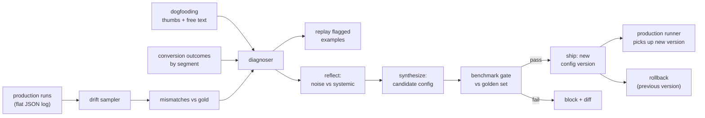

# Jagadish-agent-tuning-loops

Closed, config-driven tuning loops for a multi-agent system: golden
labels are the source of truth, production runs are sampled at a
cadence, one diagnoser localizes which agent(s) need tuning across
several feedback-loop types, a reflect/synthesize pair proposes a
new config, and a benchmark gate ships it only if guardrail
metrics pass. Configs are versioned, and rollback restores prior
behavior exactly. The demo target is the fictional food
marketplace **Savorlane** (a fictional name; the sibling repo
Jagadish-visual-content-agents uses the same marketplace), and
the demo input is that pipeline's flat run-log format.

> **Synthetic demo data, stub agents.** No real agents, models,
> photos, or user data are involved. The "agents" tuned here are
> small deterministic stand-ins for router, QA-gate, and publish
> decisions (see `docs/adr-001-stub-agents.md`), and the golden
> labels are fixture data labeled by a written guide -- not
> collected human labels. This repo proves the loop machinery:
> sampling, diagnosis, tuning, gating, versioning, rollback. It
> does not claim production tuning results. Nothing here is
> deployed. This is an independent portfolio project, not
> affiliated with any real company.

## Recruiter summary

- **Problem:** a shipped agent system drifts. Production data
  changes, a router starts approving bad items, a QA gate lets
  bad publishes through -- and teams notice only when customers
  do. Hand-tuning prompts between incidents does not scale.
- **Approach:** sample production runs against a golden set,
  diagnose across drift mismatches, dogfooding signals, and
  sliced conversion outcomes, reflect noise out and systemic
  issues in, synthesize a candidate config, and ship it only
  through a benchmark gate with recall guardrails, regression
  blocking, and rollback.
- **Proof (demo, real runs, 36 golden cases):** baseline router
  recall 0.667, case accuracy 0.472, 5 published-bad. Round 1
  blocked on recall 0.875 below the 0.90 guardrail. Round 2
  shipped: recall 1.0, accuracy 1.0, 0 published-bad. Worst
  segment (sushi) recall 0.5 -> 1.0 with no global degradation.
  Rollback to v1 reproduces baseline metrics exactly. 113 tests
  green.

## Purpose and who it is for

For anyone running agents in production who has felt the second
failure mode of agent systems: not the launch, but the slow
decay after it. The transferable patterns are golden sets with
written labeling guides, recall as a guardrail metric (a bad
item approved is worse than a good item reworked), one
diagnoser across many feedback channels, reflect/synthesize
autotuning with benchmark gating, config versioning with
rollback, and segment-sliced validation so a fix for one
segment never silently harms the rest.

## Architecture



## How it works, step by step

1. **Golden set** (`tuning/labels.py`): 36 labeled cases across
   geography, device, dish type, and quality tier, labeled by
   the written guide in `knowledge/labeling-guide.md`. The guide
   bar for routing is 0.80; the QA gold rule blocks five
   failure classes with a 0.70 floor.
2. **Production batch** (`tuning/runner.py`): the simulated
   runner executes the current config over cases and emits one
   flat JSON record per run in the sibling pipeline's schema
   (same keys, plus optional `geo`/`device` segment keys).
3. **Sample** (`tuning/sampler.py`): records are sampled at a
   regular cadence, or capped per segment, and compared with
   golden labels. A publish mismatch is counted only when the
   route was right: when the router skipped a case, the publish
   outcome is downstream of that skip, not a second failure.
4. **Diagnose** (`tuning/diagnoser.py`): drift mismatches,
   dogfooding signals, and conversion outcomes are combined.
   A segment whose conversion trails the global rate by more
   than 0.10 is flagged, and attributed to an agent only when
   that segment's cases also mismatch on that agent. Flagged
   examples (good and bad) are replayed through the current
   config before any change.
5. **Reflect** (`tuning/reflect.py`): mismatches group by
   (agent, pattern); a group becomes a systemic issue only on
   recurrence (2+ cases). Singletons are noise and never reach
   the synthesizer.
6. **Synthesize** (`tuning/synthesize.py`): deterministic,
   direction-checked adjustments. Skipped-bad raises router
   bars; enhanced-good lowers them; published-bad blocks lax
   QA classes and raises the floor; withheld-good does the
   reverse. Thresholds clamp to [0.30, 0.95]. Unknown patterns
   change nothing.
7. **Benchmark gate** (`tuning/benchmark.py`): the candidate is
   scored on the golden set. It ships only if recall >= 0.90,
   case accuracy >= baseline, zero regressions (a case that
   passed before and fails now blocks, with the diff), and
   zero published-bad.
8. **Store** (`tuning/store.py`): versioned configs. Register
   refuses without a passing ship decision; rollback refuses
   with a single version. Rollback restores the previous
   version object, so behavior is identical by construction.
9. **Loop** (`tuning/demo.py`): a blocked candidate becomes
   the next round's current config, up to three rounds. Then
   the shipped config is validated per segment, and rollback
   is proven by re-benchmarking.

## Real code excerpts and their real output

The demo (`python3 scripts/render_demo.py`):

```text
golden cases: 36
baseline: recall 0.667, precision 1.0, case accuracy 0.472, published_bad 5
diagnosis targets: ['publish', 'router']
segment flags: [['device', 'android', 0.333, 0.472], ['dish_type', 'sushi', 0.333, 0.472], ['geo', 'us-west', 0.333, 0.472]]
round 1: thresholds {'sharpness': 0.75, 'composition': 0.75, 'color': 0.75, 'plating': 0.75}, floor 0.65, blocked ['added', 'count_unknown', 'generic', 'incoherent', 'removed'] -> recall 0.875, accuracy 0.75, published_bad 0, ship=False (recall 0.875 below guardrail 0.9)
round 2: thresholds {'sharpness': 0.8, 'composition': 0.8, 'color': 0.8, 'plating': 0.8}, floor 0.7, blocked ['added', 'count_unknown', 'generic', 'incoherent', 'removed'] -> recall 1.0, accuracy 1.0, published_bad 0, ship=True (all guardrails pass)
shipped v2: recall 1.0, accuracy 1.0, published_bad 0
segment sushi recall: 0.5 -> 1.0
rollback to v1: recall 0.667, matches baseline: True
runner published_bad: shipped 0, rolled 5
tuning log entries: 11
```

The round-1 block is the point: the gate refused a candidate
that improved every aggregate except the guardrail, and the
loop fixed it in round 2 instead of shipping a near-miss.

## How to run

```bash
python3 -m pytest -q            # full suite (113 tests)
python3 scripts/render_demo.py  # the end-to-end loop, real numbers
python3 scripts/count_tests.py  # TOTAL TESTS from pytest collection
python3 scripts/brand_check.py  # hash-based real-name guard
```

Offline, stdlib only, no keys, no network. Python 3.12.

## Guardrails and security controls

- Ship/block and rollback gates fail closed: register without
  a passing ship decision is refused, rollback with one
  version is refused, and a benchmark with no golden cases
  scores zero, never ships.
- Every gate has bypass / reject / absent-path tests, not just
  happy paths (see `tests/test_store.py`, `tests/test_benchmark.py`).
- The tuning log is append-only JSONL: no delete, no edit, no
  truncate. Every loop step is auditable.
- No real user data: golden cases, run records, dogfooding
  signals, and outcomes are all fixture data.
- Brand guard: `scripts/brand_check.py` stores real-company
  names only as SHA-256 hashes, never in plain text.

## Limitations and known failures

- The target agents are stubs. The loop proves tuning
  machinery, not that any real agent would improve by these
  amounts. Real agents would need real golden labels collected
  from labelers, not fixtures.
- The synthesizer adjusts thresholds and blocked classes only.
  It cannot invent new rubric criteria, rewrite prompts, or
  retrain models. Prompt rewriting is Planned, not built.
- Segment tuning is validated per segment, but the config
  itself is global: per-segment config overrides are Planned.
- The demo's conversion outcomes are derived from baseline
  pass/fail, not observed purchases. Segment flags in the demo
  are therefore illustrative of the mechanism, not findings
  about any marketplace.
- Full list: `docs/limitations.md`.

## Built vs planned table

| Item | Status |
|---|---|
| Golden label set with written guide + cut coverage | Built |
| Drift sampler over sibling-schema flat run logs | Built |
| Multi-source diagnoser (drift, dogfooding, conversion) | Built |
| Reflect (noise vs systemic) + synthesize (direction-checked) | Built |
| Benchmark gate: recall guardrail, regression block, published-bad | Built |
| Versioned config store with enforced ship + rollback | Built |
| Segment-sliced validation (sushi 0.5 -> 1.0, global unharmed) | Built |
| Append-only tuning log | Built |
| Per-segment config overrides | Planned |
| Prompt-rewriting synthesizer (vs threshold/class edits) | Planned |
| Live-model adapters (real agents behind the same loop) | Written-not-run |
| Deployment of any kind | Planned (not started) |

## Related repos

- **Jagadish-visual-content-agents** (sibling): the pipeline
  whose flat run log is this system's input, and whose agents
  this loop's stubs mirror. Its router, QA gate, pass@K, and
  Swiss-cheese publish QA are the thing being kept sharp.
- **Jagadish-agent-feedback-loop**: one feedback loop done
  deeply (user corrections -> golden cases -> ship/block
  gate). This repo generalizes across loop types and adds
  drift, dogfooding, and conversion signals plus autotuning.
- **Jagadish-agent-trace-observability**: trace capture and
  failure mining. Its exported failures are a natural fourth
  diagnoser input (Planned).
- **Jagadish-dspy-prompt-optimizer**: prompt search on static
  validation sets. This repo's autotuner differs: it is
  triggered by production drift, gated on a golden set, and
  versioned with rollback.
