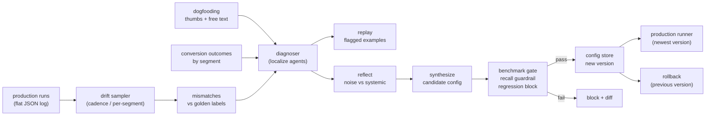

# Architecture

## Module map

| Module | Owns |
|---|---|
| `tuning/labels.py` | Golden cases, labeling guide in code, cut coverage |
| `tuning/agents.py` | Stub router / QA / publish agents + configs |
| `tuning/sampler.py` | Cadence + per-segment sampling, mismatch detection |
| `tuning/diagnoser.py` | Multi-source diagnosis, replay, segment conversion |
| `tuning/reflect.py` | Noise vs systemic grouping with evidence |
| `tuning/synthesize.py` | Direction-checked config edits |
| `tuning/benchmark.py` | Golden-set metrics, ship/block decisions |
| `tuning/store.py` | Versioned configs, enforced ship, rollback |
| `tuning/runner.py` | Simulated production, sibling-schema records |
| `tuning/log.py` | Append-only JSONL tuning log |
| `tuning/demo.py` | The full loop end to end |

## Data flow

Golden cases are the only ground truth. Production records
flow in through the sampler; mismatches flow to the
diagnoser together with dogfooding and conversion signals;
the diagnoser's targets flow to reflect; systemic issues
flow to synthesize; the candidate flows to the benchmark;
the benchmark's decision flows to the store; the store's
current version flows to the runner. Nothing flows backward
except rollback, which is a deliberate, logged reversal.
